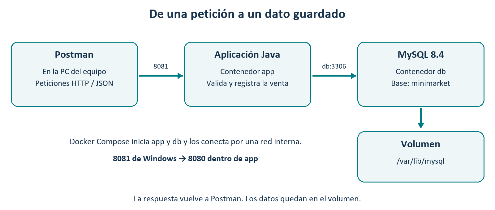
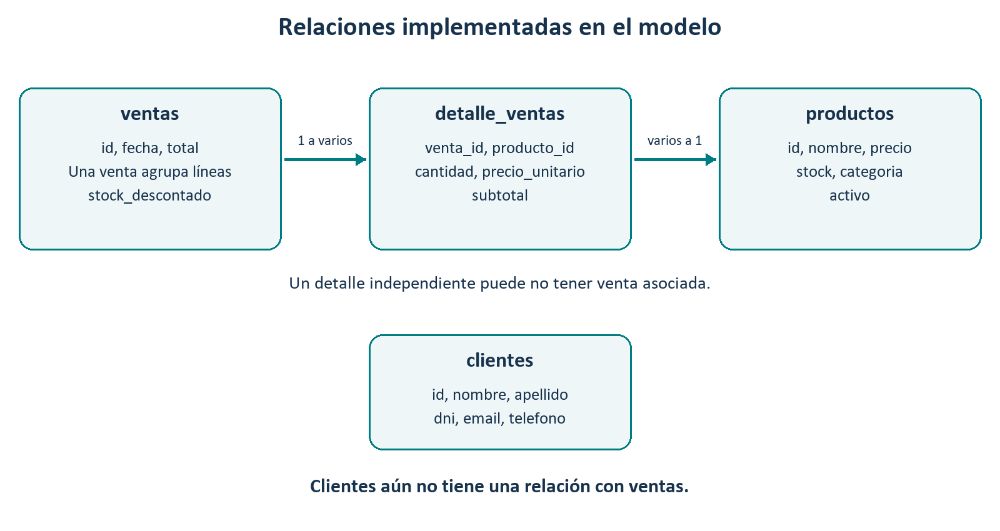
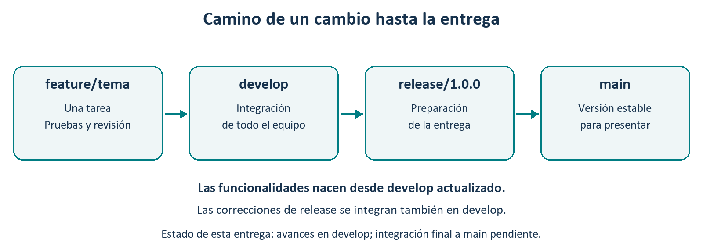

# Minimarket: documentación completa para el equipo

Guía de comprensión, ejecución y continuidad del proyecto.

**Fecha de revisión:** 22 de octubre de 2026. **Versión de código documentada:** `ae2cff0`, integrada en `develop`. **Repositorio:** [Proyecto Herramientas de Desarrollo](https://github.com/Mauricioo-RS/Proyecto-Herramientas-de-desarrollo).

Este documento explica el trabajo realizado y cómo reproducirlo. Los ejemplos están preparados para Windows, PowerShell, Docker Desktop y Postman. Los nombres de archivos y las reglas de las APIs se contrastaron con el código del proyecto. Los estados de Git, Docker y Actions corresponden a la fecha de revisión y pueden cambiar con nuevos avances.

**Cómo leerlo:** para empezar desde cero, leer los capítulos 1 a 7; para comprobar el programa, seguir los capítulos 8 a 11; para trabajar en equipo y preparar la entrega, revisar los capítulos 12 a 16. Los comandos se ejecutan en la carpeta raíz del repositorio, salvo cuando se indica expresamente la consola de MySQL.

## 1. Qué tenemos construido y qué pidió el profesor

El proyecto es un servicio de backend para un minimarket. Recibe peticiones HTTP, aplica reglas del negocio y guarda información en una base de datos. Actualmente se prueba con Postman; no contiene una pantalla de caja o una página web para un vendedor.

Según lo comunicado en clase, debemos trabajar con Gitflow, usar Docker, probar las APIs con Postman, disponer de un workflow que funcione y entregar una versión operativa en `main` o `master`. En este repositorio la rama principal se llama `main`. La mención de un runner no confirma por sí sola que el profesor exija un runner instalado en una PC del equipo; ese detalle debe aclararse antes de implementar otro despliegue automático.

| Área | Estado comprobado | Qué significa para el equipo |
| --- | --- | --- |
| Integración | Productos, clientes, ventas y detalles integrados | Los cuatro módulos están en el mismo servicio |
| Inventario | Cálculo de importes, descuento y restitución de stock | Una venta válida modifica existencias de manera controlada |
| Docker | Aplicación y MySQL en contenedores saludables | El proyecto puede iniciarse con Compose |
| Persistencia | MySQL utiliza un volumen; reinicio verificado | Los registros no dependen de que el contenedor siga encendido |
| Pruebas Java | 24 pruebas; cero fallos y errores en los informes revisados | Hay comprobaciones automáticas de integración y ventas |
| GitHub Actions | Ejecución exitosa en `develop`, commit `ae2cff0` | El workflow ya está implementado y ha funcionado en GitHub |
| Entrega a `main` | Aún no contiene estos últimos avances | Falta integrar y comprobar la versión final en esa rama |
| Colección Postman | Se hicieron pruebas manuales; falta la colección compartida | Debemos entregar peticiones guardadas y reproducibles |

El código de los módulos está unificado en `develop`. Esto no significa que todas las ramas tengan exactamente los mismos commits: una rama conserva su propia historia hasta que se integra o actualiza. Tampoco significa que los datos de la PC de Mauricio estén publicados; Git distribuye el código y la configuración de ejemplo, no la base local.

## 2. Qué papel tiene cada herramienta

| Concepto | Explicación aplicada al minimarket |
| --- | --- |
| API | Conjunto de operaciones que ofrece el programa: crear un producto, consultar una venta, etc. |
| Endpoint | Dirección de una operación, combinada con su método; por ejemplo GET `/api/productos` |
| HTTP y JSON | HTTP transporta la petición; JSON representa los datos enviados y recibidos |
| Postman | Cliente con el que enviamos peticiones y revisamos respuestas de la API |
| Java y Spring Boot | Ejecutan la aplicación y conectan sus componentes |
| Maven Wrapper | Compila, ejecuta pruebas y genera el archivo JAR usando la configuración del proyecto |
| H2 / MySQL | Motores de base de datos; se usan en modalidades distintas de ejecución |
| Git | Guarda versiones del código y permite trabajar con ramas |
| GitHub | Aloja el repositorio remoto y las revisiones mediante Pull Requests |
| Gitflow | Forma de organizar el trabajo con ramas de funcionalidades, integración y entrega |
| Workflow | Secuencia automática descrita en un archivo YAML |
| Runner | Máquina que ejecuta los pasos de un workflow |
| CI | Integración continua: comprobar automáticamente cada cambio incluido en los eventos configurados |

Una petición recorre este camino:



Ejemplo: Postman solicita vender dos bolsas de arroz. Java consulta el producto, comprueba existencias, calcula el precio y registra la venta en MySQL. Después devuelve una respuesta JSON. Postman muestra el resultado, pero las reglas del negocio están en Java.

Docker utiliza **imágenes**, que son las plantillas con el software necesario, y **contenedores**, que son las instancias creadas a partir de ellas. En nuestro proyecto hay una imagen MySQL y otra de la aplicación. Docker Desktop permite verlas y administrar su ejecución. Referencia: [concepto de contenedor en Docker](https://docs.docker.com/get-started/docker-concepts/the-basics/what-is-a-container/).

Docker Compose reúne la configuración de los servicios, su red, puertos y almacenamiento en `compose.yaml`. Un volumen conserva los archivos de MySQL fuera de la capa de escritura del contenedor. En este proyecto, el servicio `db` monta ese almacenamiento en `/var/lib/mysql`. Referencia: [volúmenes de Compose](https://docs.docker.com/reference/compose-file/volumes/).

Gitflow organiza cómo se integran los cambios; GitHub Actions ejecuta las comprobaciones configuradas. Un merge a `develop` es una operación de Git; la ejecución que aparece después en Actions es una consecuencia del evento `push` configurado en el workflow.

## 3. Recorrido del trabajo que realizamos

Primero se revisó el repositorio y se integraron las funcionalidades de productos, ventas, detalles y clientes. Las primeras pruebas se hicieron ejecutando Java directamente, con H2 y el puerto 8080. Se comprobó la creación y consulta de productos, la actualización de precio y stock, el registro de clientes y el guardado de ventas con sus detalles.

Las pruebas revelaron dos problemas en ventas: la respuesta inicial mostraba campos del producto como `null` cuando se enviaba solamente su ID, y registrar una venta no descontaba inventario. Se corrigió el servicio para cargar el producto real, calcular importes desde el catálogo y controlar existencias dentro de una transacción. También se incorporaron pruebas para impedir ventas con cantidades inválidas o sin stock.

Después se preparó Docker con MySQL. Durante la práctica manual se creó el volumen `minimarket-datos` y se intentó publicar MySQL en 3307. Windows tenía reservado el rango 3252–3351, que también incluye 3305; se eligió 13306. Más adelante se incorporó la aplicación al mismo proyecto de Compose, con puerto externo 8081 y el perfil `docker`.

Se comprobó que las tablas y registros podían consultarse en MySQL y que persistían al detener e iniciar los contenedores. Finalmente, se automatizaron compilación, pruebas, construcción de Docker, comprobaciones HTTP y persistencia mediante GitHub Actions. Se integró el avance en `develop` y se confirmó una ejecución exitosa.

| Commit | Avance registrado |
| --- | --- |
| `7ac0330` | Cálculo de importes y control atómico del inventario en ventas |
| `72fbd63` | Ejecución de la aplicación con Docker y MySQL; verificación de persistencia |
| `e3bda20` | Primera versión del workflow de Java, Docker, APIs y persistencia |
| `66c9217` | Documentos de avances y pendientes; ajuste del reinicio en CI |
| `ae2cff0` | Merge de los avances hacia `develop` |

La primera ejecución de CI falló al usar una opción de Compose incompatible con la versión del runner. Se corrigió el arranque posterior al `stop` usando `docker compose up -d --no-recreate --wait`. Las ejecuciones siguientes pasaron. El fallo anterior permanece en el historial como evidencia de esa versión; no invalida la ejecución posterior corregida.

## 4. Cómo está organizado el código

La aplicación sigue principalmente este recorrido: **Controller → Service → Repository → base de datos**. Las entidades representan los datos persistentes. Los DTO definen datos de entrada o salida cuando el módulo los utiliza.

| Capa o archivo | Responsabilidad y ejemplo real |
| --- | --- |
| Controller | Recibe HTTP, lee parámetros y devuelve la respuesta; `ProductoController` atiende `/api/productos` |
| Service | Aplica reglas del negocio; `VentaService` valida stock y calcula el total |
| Repository | Accede a la persistencia mediante Spring Data JPA; `ProductoRepository` busca productos y bloquea filas al vender |
| Entity / model | Define datos y relaciones; `Producto`, `Venta`, `DetalleVenta` y `Cliente` |
| DTO | Define un contrato de entrada o salida; `ClienteRequestDTO` y `ClienteResponseDTO` |
| Mapper | Convierte DTO y entidad; `ClienteMapper` realiza esa conversión |
| Exception handler | Traduce errores de ventas y detalles a respuestas HTTP; `VentaExceptionHandler` |

Las rutas siguientes son relativas a `src/main/java/com/proyecto/minimarket/`:

| Ubicación | Contenido |
| --- | --- |
| `MinimarketApplication.java` | Punto de entrada de Spring Boot |
| `productos/` | Entidad, controlador, servicio y repositorio de productos |
| `Cliente/` | Capas de clientes, DTO y mapper; el nombre actual comienza con mayúscula |
| `model/` | Entidades de ventas y detalles |
| `controller/` | Controladores de ventas, detalles y su manejador de errores |
| `service/` | Reglas de ventas y detalles |
| `repository/` | Repositorios de ventas y detalles |
| `DTO/DetalleVentaDTO.java` | Clase DTO existente, todavía sin uso en controladores o servicios |

**Aclaración sobre el archivo DetalleVentaDTO.java:** contiene `id`, `ventaId`, `productoId`, `cantidad`, `precioUnitario` y `subtotal`. Sus importes siguen declarados como `Double`. Sin embargo, las APIs actuales de ventas y detalles reciben las entidades y trabajan con `BigDecimal`. Encontrar este DTO en el proyecto no significa que el JSON esperado sea `productoId`; actualmente se utiliza `"producto": {"id": ...}`. Si se decide adoptar ese DTO, habrá que conectarlo explícitamente, revisar sus tipos y añadir pruebas del contrato.

| Archivo de configuración o apoyo | Para qué sirve |
| --- | --- |
| `pom.xml` | Java 21, Spring Boot 4.1.1, dependencias y construcción Maven |
| `mvnw`, `mvnw.cmd`, `.mvn/` | Wrapper Maven incluido en el repositorio |
| `src/main/resources/application.properties` | Configuración base: H2 en archivo y actualización del esquema |
| `src/main/resources/application-docker.properties` | Conexión MySQL al activar el perfil Docker |
| `src/test/resources/application.properties` | Base H2 en memoria para las pruebas |
| `Dockerfile` | Construcción y ejecución de la imagen Java |
| `compose.yaml` | Servicios `app` y `db`, puertos, volumen y comprobaciones de salud |
| `.env.example` | Plantilla de configuración local sin las contraseñas reales |
| `.github/workflows/ci.yml` | Workflow de GitHub Actions |
| `scripts/probar_docker.py` | Comprobaciones HTTP contra la aplicación iniciada |

`target/` contiene resultados de compilación e informes. `data/` contiene la base H2 local. Ambos están excluidos de Git. `.env` también está excluido. `.dockerignore` limita lo que entra en la construcción de la imagen y evita incorporar esos datos locales.

## 5. Base de datos y relaciones entre tablas

Hay cuatro tablas principales. Una **base de datos** es el conjunto organizado de información; una **tabla** agrupa registros del mismo tipo; una **fila** representa un registro. MySQL es el motor que administra la base `minimarket`; Docker ejecuta ese motor en un contenedor.



| Tabla | Columnas principales | Significado |
| --- | --- | --- |
| `productos` | `id`, `nombre`, `descripcion`, `precio`, `stock`, `categoria`, `activo` | Catálogo y existencias actuales |
| `ventas` | `id`, `fecha`, `total`, `stock_descontado` | Cabecera de cada venta |
| `detalle_ventas` | `id`, `producto_id`, `venta_id`, `cantidad`, `precio_unitario`, `subtotal` | Líneas con los productos y cantidades |
| `clientes` | `id`, `nombre`, `apellido`, `dni`, `email`, `telefono` | Datos registrados de clientes |

Una venta contiene varios detalles. Cada detalle apunta a un producto. Un producto puede aparecer en muchos detalles a lo largo del tiempo. La relación de venta se administra desde `Venta.detalles`, con la columna `venta_id` en la tabla de detalles. El servicio también permite crear detalles independientes, por lo que puede haber filas sin una venta asociada.

**Clientes todavía no está relacionado con ventas.** Registrar a Ana no hace que la siguiente venta le pertenezca. Consultar su frecuencia de compra requeriría incorporar esa relación, adaptar la API y definir cómo registrar ventas a personas que no deseen identificarse.

El campo interno `stock_descontado` diferencia las ventas creadas con el control de inventario de las ventas anteriores que nunca descontaron stock. No aparece en el JSON de la API. Al eliminar una venta nueva se devuelve el stock que descontó; al eliminar una antigua no se crean existencias artificialmente.

Los IDs se generan en la base de datos. No se debe asumir que siempre comienzan en 1 o que son consecutivos: registros eliminados o intentos de inserción pueden dejar saltos. Cada prueba debe usar el ID devuelto por su propio POST.

### H2 y MySQL son almacenamientos diferentes

| Modalidad | Dirección de la API | Base y ubicación |
| --- | --- | --- |
| Java con Maven, configuración por defecto | `http://localhost:8080` | H2: archivo `data/minimarket.mv.db` |
| Aplicación en Docker, perfil `docker` | `http://localhost:8081` | MySQL: volumen montado en `/var/lib/mysql` |
| Pruebas automatizadas de Java | Contexto de pruebas | H2 en memoria, separado de los datos manuales |

`minimarket.mv.db` es un **archivo binario**, no una carpeta ni un documento de texto. Que VS Code no muestre filas al abrirlo no demuestra que esté vacío. En la revisión se verificó que existe y tiene contenido. Las tablas se consultan a través del motor de base de datos, no editando ese archivo.

Los productos creados anteriormente en H2 no se copian automáticamente a MySQL. Al cambiar de 8080 a 8081 puede aparecer `[]` porque la segunda base todavía no tiene productos activos. Clonar el repositorio en otra computadora tampoco copia los datos de ninguna de esas bases.

## 6. Cómo funciona nuestra configuración de Docker

El proyecto de Compose se llama `minimarket`. Dentro aparecen el servicio `db`, con MySQL 8.4, y el servicio `app`, con la aplicación Java 21. En la instalación revisada los contenedores se llaman `minimarket-mysql` y `minimarket-app-1` y ambos reportan `healthy`.

### Dockerfile: construir y ejecutar

La primera etapa utiliza `eclipse-temurin:21-jdk-jammy`. Copia el wrapper, el `pom.xml` y el código, ejecuta Maven con `verify` y genera el JAR. Las pruebas forman parte de esa construcción; si fallan, esa etapa no termina correctamente.

La segunda etapa utiliza `eclipse-temurin:21-jre-jammy`. Recibe el JAR construido y lo ejecuta como un usuario de aplicación sin privilegios de root. Java escucha en el puerto 8080 del contenedor. El código se incorpora al construir la imagen: modificar un archivo Java en VS Code requiere reconstruir para que Docker ejecute ese cambio.

### Compose: iniciar componentes y conectarlos

| Configuración | Efecto en este proyecto |
| --- | --- |
| `SPRING_PROFILES_ACTIVE=docker` | Activa la conexión MySQL en la aplicación |
| `MYSQL_DATABASE=minimarket` | Solicita crear la base al inicializar un almacenamiento nuevo |
| `MYSQL_USER=minimarket` | Usuario con el que accede la aplicación |
| `DB_PASSWORD` | Recibe el valor local de `MYSQL_PASSWORD` |
| `depends_on` con `service_healthy` | Espera a que la comprobación de MySQL pase antes de iniciar la aplicación |
| Healthcheck de MySQL | Comprueba una consulta `SELECT 1` con el usuario de aplicación |
| Healthcheck de la aplicación | Consulta `/api/productos` dentro del contenedor |
| `restart: unless-stopped` | Define el comportamiento de reinicio de los contenedores |
| Zona horaria | Se configura America/Lima en MySQL y en la JVM |

Las tablas las crea o actualiza Hibernate/JPA al conectarse la aplicación, debido a `spring.jpa.hibernate.ddl-auto=update`. El contenedor de MySQL proporciona el motor; no conoce las clases Java ni crea por sí solo las cuatro tablas del negocio.

### Puertos: desde dónde se conecta cada programa

| Origen → destino | Dirección | Uso |
| --- | --- | --- |
| Postman → aplicación Docker | `localhost:8081` | Peticiones HTTP |
| Cliente SQL en Windows → MySQL | `127.0.0.1:13306` | Consultas SQL |
| Aplicación Docker → MySQL | `db:3306` | Conexión JDBC en la red interna |
| Java ejecutado con Maven | `localhost:8080` | API con H2 por defecto |

El mapeo `8081:8080` significa puerto de Windows 8081 hacia puerto del contenedor 8080. El mapeo `13306:3306` aplica la misma idea a MySQL. `localhost` dentro de `app` se refiere al propio contenedor; por eso la conexión a la base utiliza el nombre de servicio `db`.

### Volumen de la práctica y volumen de una instalación nueva

La PC de la práctica reutiliza `minimarket-datos` como volumen externo. En esa configuración local se utiliza:

```dotenv
MYSQL_VOLUME_NAME=minimarket-datos
MYSQL_VOLUME_EXTERNAL=true
```

Un integrante que empieza desde cero debe usar los valores de `.env.example`: `MYSQL_VOLUME_NAME=minimarket_mysql_data` y `MYSQL_VOLUME_EXTERNAL=false`. Así Compose crea el volumen. Un volumen externo debe existir previamente; esta diferencia evita pedir a cada compañero que replique manualmente la práctica anterior. Referencia: [atributo external de los volúmenes](https://docs.docker.com/reference/compose-file/volumes/#external).

Las contraseñas de `.env` deben coincidir con las cuentas de una base ya inicializada. Cambiar el archivo no cambia automáticamente las contraseñas guardadas en un volumen existente. La configuración actual del JDBC se preparó para la práctica local; no se presenta como una configuración de producción en Internet.

## 7. Iniciar el proyecto en otra computadora

### Ruta recomendada para la demostración: Docker y MySQL

Se necesita Git, Docker Desktop con contenedores Linux, Docker Compose y acceso a Internet para la primera descarga. Postman se utiliza para las pruebas manuales. Python es necesario solamente si se va a ejecutar el script de comprobación. No es necesario instalar Java o MySQL en Windows para usar esta ruta: la imagen construye y ejecuta Java, y el otro contenedor ejecuta MySQL.

1. Abrir Docker Desktop y comprobar que el motor esté iniciado.
2. Clonar el repositorio y seleccionar `develop` para obtener el avance documentado.

```powershell
git clone https://github.com/Mauricioo-RS/Proyecto-Herramientas-de-desarrollo.git
cd Proyecto-Herramientas-de-desarrollo
git switch develop
git pull --ff-only origin develop
```

Si el repositorio ya está descargado, no se vuelve a clonar. Revisar antes `git status`; guardar o confirmar los cambios propios antes de cambiar de rama. Los comandos de actualización no deben utilizarse para descartar trabajo de un compañero.

3. Preparar la configuración local. El siguiente comando copia la plantilla únicamente si todavía no existe `.env`.

```powershell
if (-not (Test-Path -LiteralPath .env)) {
    Copy-Item -LiteralPath .env.example -Destination .env
}
```

Abrir `.env` y reemplazar los valores de ejemplo de `MYSQL_PASSWORD` y `MYSQL_ROOT_PASSWORD` por claves locales propias. Mantener, en una instalación nueva, `APP_PORT=8081`, `DB_PORT=13306`, `MYSQL_VOLUME_NAME=minimarket_mysql_data` y `MYSQL_VOLUME_EXTERNAL=false`. Este archivo no se sube a Git.

4. Construir e iniciar los servicios.

```powershell
docker compose up -d --build --wait --wait-timeout 300
docker compose ps
```

`-d` deja los servicios funcionando en segundo plano. `--build` construye la imagen con el código actual. `--wait` espera a que se cumplan las comprobaciones de salud. La primera construcción puede tardar por las descargas; los logs permiten distinguir una descarga de un error.

5. Comprobar que `app` y `db` estén `healthy`. En Postman seleccionar GET y usar únicamente esta dirección:

```text
http://localhost:8081/api/productos
```

Una respuesta `200 OK` con `[]` es válida cuando no hay productos activos. Crear un producto según el capítulo siguiente permite probar la escritura.

### Uso diario

| Necesidad | Comando en PowerShell |
| --- | --- |
| Ver servicios | `docker compose ps` |
| Ver últimos mensajes de Java | `docker compose logs --tail 50 app` |
| Ver últimos mensajes de MySQL | `docker compose logs --tail 50 db` |
| Detener conservando contenedores y datos | `docker compose stop` |
| Volver a iniciar | `docker compose up -d --wait` |
| Aplicar cambios del código | `docker compose up -d --build --wait --wait-timeout 300` |

`docker compose down` elimina los contenedores y la red del proyecto, conservando los volúmenes nombrados. Añadir `-v` elimina también los volúmenes administrados por Compose, con sus datos; los externos tienen un ciclo de vida separado. Para cerrar una sesión de trabajo sin perder datos basta con `stop`.

### Ruta alternativa para desarrollar: Maven y H2

Se necesita JDK 21. Configurar `JAVA_HOME` según la ubicación real del JDK y añadir su carpeta `bin` al PATH. La PC de la práctica utilizó Corretto 21; la ruta puede variar en otro equipo. Comprobar la versión antes de iniciar:

```powershell
java -version
.\mvnw.cmd -B -ntp clean verify
.\mvnw.cmd spring-boot:run
```

El wrapper proporciona Maven. El comando de arranque permanece ejecutándose; `Ctrl+C` lo detiene. Esta modalidad usa `http://localhost:8080` y H2 en `data/`. Ejecutar las pruebas no requiere que la aplicación manual esté iniciada.

## 8. Probar las APIs en Postman, paso a paso

Esta práctica utiliza la aplicación de Docker en **8081** y datos de prueba propios. Si otra persona modifica esos mismos registros durante la prueba, los valores esperados pueden cambiar.

En cada petición elegir el método en el desplegable, pegar solo la URL, configurar el cuerpo cuando corresponda y pulsar **Send**. Para POST y PUT seleccionar **Body → raw → JSON**. Para las consultas GET no hace falta cuerpo. La API actual no exige un token de acceso. Si se reutiliza una pestaña de otro proyecto, revisar que no conserve autenticación o datos ajenos. Referencia: [crear y enviar una petición en Postman](https://learning.postman.com/docs/use/send-requests/create-requests/request-basics).

### 8.1 Consultar el catálogo

Método: **GET**. URL:

```text
http://localhost:8081/api/productos
```

Resultado esperado: `200 OK` y una lista JSON. `[]` significa que la consulta se atendió y no devolvió productos activos. No significa que la aplicación esté apagada.

### 8.2 Crear un producto

Método: **POST**. URL:

```text
http://localhost:8081/api/productos
```

Cuerpo JSON:

```json
{
  "nombre": "Arroz practica equipo",
  "descripcion": "Bolsa de 1 kg",
  "precio": 5.00,
  "stock": 30,
  "categoria": "Abarrotes"
}
```

Resultado esperado: `201 Created`. La respuesta añade un `id` y normalmente `activo: true`. Anotar el ID como **ID_PRODUCTO**. Si ya existe ese nombre, utilizar otro nombre de prueba, porque el catálogo exige nombres únicos.

### 8.3 Consultar o actualizar ese producto

Si el POST devolvió el ID 2, usar GET con:

```text
http://localhost:8081/api/productos/2
```

Reemplazar 2 por el ID real. Para actualizar, seleccionar PUT en esa misma URL y enviar el cuerpo completo con nombre, descripción, precio, stock y categoría. El código actual reemplaza esos campos; no debe tratarse como una modificación parcial. Mantener precio 5.00 y stock 30 si se desea seguir exactamente los resultados de esta práctica.

En la práctica inicial se verificó una actualización de precio de 4.50 a 5.00 y de stock de 20 a 30. Después se hizo GET para comprobar que los nuevos valores se habían guardado.

### 8.4 Crear un cliente

Método: **POST**. URL:

```text
http://localhost:8081/api/v1/clientes
```

```json
{
  "nombre": "Ana",
  "apellido": "Prueba",
  "dni": "12345678",
  "email": "ana@example.com",
  "telefono": "987654321"
}
```

Resultado esperado: `201 Created`. Usar un DNI de prueba de ocho dígitos que todavía no exista en esa base. Guardar el ID como **ID_CLIENTE**. Para consultar, usar GET en la misma ruta con `/ID_CLIENTE` al final, sustituyendo ese texto por el número. Para actualizar se usa PUT; el servicio conserva el DNI original aunque el cuerpo contenga otro DNI válido.

Este paso demuestra el módulo de clientes. La venta del siguiente paso todavía no se asocia con Ana, porque esa relación no está implementada.

### 8.5 Registrar una venta

Método: **POST**. URL:

```text
http://localhost:8081/api/ventas
```

Ejemplo si ID_PRODUCTO es 2; sustituirlo por el ID obtenido:

```json
{
  "detalles": [
    {
      "producto": { "id": 2 },
      "cantidad": 2
    }
  ]
}
```

No enviar ID de venta ni de detalle al crear. No es necesario enviar precio, subtotal, total ni fecha. El servicio obtiene el precio del catálogo y usa la fecha del servidor cuando no se envía una fecha.

Resultado esperado: `201 Created`; cantidad 2; precio unitario 5.00; subtotal y total 10.00; producto completo con stock 28. Guardar el ID de la venta como **ID_VENTA**. Si el JSON muestra 10 o 10.0, representa el mismo valor numérico de este ejemplo.

### 8.6 Confirmar la venta y sus detalles

Consultar con GET `/api/ventas/ID_VENTA` y `/api/productos/ID_PRODUCTO`, sustituyendo los IDs y usando la base `http://localhost:8081`. La venta debe existir y el stock debe ser 28.

Después usar GET con:

```text
http://localhost:8081/api/detalle-ventas
```

Debe aparecer el detalle generado por la venta. Puede haber otros detalles de pruebas anteriores. Identificar el correspondiente mediante su ID, producto y cantidad.

### 8.7 Probar el rechazo por stock insuficiente

Volver a POST `/api/ventas` con el mismo producto y cantidad **29**, cuando solo quedan 28. Se espera `409 Conflict` y una explicación como: `Stock insuficiente para Arroz practica equipo. Disponible: 28.`

El código 409 es el resultado correcto de esta prueba: indica que la regla impidió una venta inválida. Volver a consultar el producto; debe seguir con stock 28. No debe crearse una nueva venta por ese intento.

Con cantidad 0 o negativa se espera `400 Bad Request`. Un producto inexistente devuelve `404` desde la operación de ventas. Un producto desactivado devuelve `409`. Estos códigos se refieren a las validaciones implementadas en ventas y detalles; no todos los errores de los demás módulos están unificados.

### 8.8 Verificar la persistencia

Conservar los IDs y, desde PowerShell en la raíz del proyecto, ejecutar:

```powershell
docker compose stop
docker compose up -d --wait
```

Repetir las consultas al producto, cliente y venta. Deben seguir existiendo, y el producto debe conservar stock 28. Esta prueba demuestra que los registros sobreviven al reinicio. No ejecutar `down -v` para esta comprobación.

### 8.9 Probar la eliminación de la venta

Usar **DELETE** en `/api/ventas/ID_VENTA`. Se espera `204 No Content`, sin cuerpo. Consultar el producto: su stock debe volver de 28 a 30. Repetir DELETE para esa misma venta debe devolver `404` y no sumar stock otra vez.

Para limpiar otros datos de esta práctica, DELETE `/api/v1/clientes/ID_CLIENTE` elimina el cliente, mientras DELETE `/api/productos/ID_PRODUCTO` desactiva el producto. Utilizar exclusivamente los IDs de la prueba propia. El producto desactivado deja de aparecer en la lista de activos, aunque su fila permanece en la base.

### Cómo interpretar las respuestas

| Código | Interpretación en estas pruebas |
| --- | --- |
| 200 | Consulta o actualización atendida correctamente |
| 201 | Producto, cliente o venta creada |
| 204 | Operación completada sin cuerpo de respuesta |
| 400 | Datos de entrada inválidos |
| 404 | Recurso no encontrado en las operaciones que implementan este manejo |
| 409 | Conflicto con el estado del producto en ventas, como stock insuficiente |
| 500 | Error del servidor; revisar logs y manejo de excepciones |

## 9. Contrato actual de las APIs y reglas del negocio

En las tablas siguientes se omite la base `http://localhost:8081`. `{id}`, `{nombre}` y `{categoria}` son marcadores: hay que sustituirlos por valores reales. Los códigos indicados son los de éxito.

### Productos

| Método | Ruta | Resultado |
| --- | --- | --- |
| GET | `/api/productos` | 200; productos activos ordenados por nombre |
| GET | `/api/productos/{id}` | 200; producto por ID, incluso si está desactivado |
| GET | `/api/productos/nombre/{nombre}` | 200; búsqueda por nombre sin distinguir mayúsculas |
| GET | `/api/productos/categoria/{categoria}` | 200; productos activos de la categoría |
| POST | `/api/productos` | 201; crear |
| PUT | `/api/productos/{id}` | 200; actualizar campos del producto |
| DELETE | `/api/productos/{id}` | 204; desactivar |

Nombre obligatorio, único y de hasta 120 caracteres; descripción de hasta 500; precio mínimo 0.01; stock obligatorio y no negativo; categoría obligatoria y de hasta 80 caracteres. El PUT no cambia `activo`. El código permite recibir el campo `activo` al crear; para una creación normal se omite y conserva su valor por defecto verdadero.

Los errores por nombre duplicado o ID inexistente en productos utilizan excepciones que aún no tienen un manejo HTTP uniforme. No se debe prometer que todos esos casos respondan 409 o 404: estandarizarlos es una mejora pendiente.

### Clientes

| Método | Ruta | Resultado |
| --- | --- | --- |
| GET | `/api/v1/clientes` | 200; lista |
| GET | `/api/v1/clientes/{id}` | 200; consulta |
| POST | `/api/v1/clientes` | 201; crear |
| PUT | `/api/v1/clientes/{id}` | 200; actualizar, conservando el DNI original |
| DELETE | `/api/v1/clientes/{id}` | 204; eliminación física |

Nombre, apellido y DNI son obligatorios. El DNI debe tener ocho dígitos y ser único. El correo valida su formato; el teléfono, cuando se proporciona, debe tener nueve dígitos. Las excepciones por DNI duplicado y cliente inexistente son actualmente `RuntimeException`; falta traducirlas a respuestas HTTP consistentes.

### Ventas y detalles

| Método | Ruta | Resultado |
| --- | --- | --- |
| GET | `/api/ventas` | 200; lista de ventas |
| GET | `/api/ventas/{id}` | 200; venta, o 404 si no existe |
| POST | `/api/ventas` | 201; venta completa con sus detalles y descuento de stock |
| DELETE | `/api/ventas/{id}` | 204; elimina y restituye el stock que esa venta descontó |
| GET | `/api/detalle-ventas` | 200; todos los detalles |
| POST | `/api/detalle-ventas` | 200; detalle independiente, sin descuento de stock |

No hay endpoint PUT para ventas ni endpoints públicos GET por ID, PUT o DELETE para detalles, aunque el servicio de detalles tenga algunos métodos internos. Las rutas públicas las determina el controlador.

El POST independiente de detalles recibe, por ejemplo, `{"producto":{"id":2},"cantidad":2}`. Calcula el subtotal, pero no crea una venta, no descuenta inventario ni valida disponibilidad como una venta. Para vender se utiliza POST `/api/ventas`. La respuesta exitosa del POST independiente es actualmente 200, no 201.

### Qué hace VentaService cuando se registra una venta

1. Rechaza una venta con ID asignado, sin detalles o con datos inválidos en sus detalles.
2. Identifica los productos y bloquea sus filas para actualizar inventario; los busca en un orden consistente.
3. Carga y refresca el estado de cada producto desde la base.
4. Comprueba que esté activo y que tenga existencias suficientes.
5. Toma el precio real, calcula subtotal por línea y acumula el total con `BigDecimal`.
6. Descuenta cantidades, asigna fecha si falta y guarda la venta con sus detalles.
7. Confirma la transacción; si ocurre un fallo durante el proceso, revierte sus cambios.

Ejemplo de atomicidad: una venta pide arroz y leche. Aunque el arroz tenga stock, si la leche no alcanza se rechaza toda la venta; no queda una venta parcial ni se pierde stock del arroz. Si se repite un producto en varias líneas, se considera la cantidad acumulada.

El bloqueo de productos protege las ventas simultáneas frente a la venta del mismo stock. Esta comprobación no equivale a haber probado todas las combinaciones posibles de edición concurrente: por ejemplo, modificar manualmente el stock con PUT mientras otra persona vende requiere definir y revisar ese caso de uso.

Los importes guardados en el detalle conservan el precio de la operación. Si después cambia el precio del catálogo, el total histórico de la venta no se recalcula. El objeto `producto` incluido al consultar puede mostrar los datos actuales del catálogo; para el precio histórico se utiliza `precioUnitario` del detalle.

## 10. Ver las tablas y los registros de MySQL

Docker Desktop muestra contenedores y volúmenes, pero esa lista no es una vista de filas y columnas de la base. Para ver los registros hay que conectarse a MySQL con una consola o con un cliente SQL.

### Desde Docker Desktop

1. Abrir Containers y expandir el grupo `minimarket`.
2. Entrar al contenedor de MySQL y abrir su pestaña **Exec**.
3. En esa terminal Linux del contenedor ejecutar:

```sh
MYSQL_PWD="$MYSQL_PASSWORD" mysql -u minimarket minimarket
```

El comando utiliza la contraseña ya configurada en el entorno del contenedor y abre la base `minimarket` con el usuario de aplicación. Se escribe en **Exec del contenedor**, no directamente en PowerShell. Si la contraseña real de una base antigua no coincide con la variable configurada, el acceso fallará y habrá que corregir esa configuración.

Cuando aparezca `mysql>`, ejecutar SQL; cada instrucción termina en punto y coma:

```sql
SHOW TABLES;
DESCRIBE productos;
SELECT id, nombre, precio, stock, activo FROM productos;
SELECT id, fecha, total, stock_descontado FROM ventas;
SELECT id, venta_id, producto_id, cantidad,
       precio_unitario, subtotal
FROM detalle_ventas;
SELECT id, nombre, apellido, dni FROM clientes;
```

Para entender una venta con sus líneas se puede consultar:

```sql
SELECT v.id AS venta, p.nombre, d.cantidad,
       d.precio_unitario, d.subtotal, v.total
FROM ventas v
JOIN detalle_ventas d ON d.venta_id = v.id
JOIN productos p ON p.id = d.producto_id
ORDER BY v.id, d.id;
```

Para salir de MySQL:

```sql
exit;
```

Estas consultas son de lectura. Las pruebas de creación y venta conviene hacerlas por la API para que se apliquen sus validaciones y reglas de inventario.

### Desde un cliente SQL instalado en Windows

| Campo de conexión | Valor local de Docker |
| --- | --- |
| Motor | MySQL |
| Host | `127.0.0.1` |
| Puerto | `13306`, salvo cambio de `DB_PORT` |
| Base / esquema | `minimarket` |
| Usuario | `minimarket` |
| Contraseña | Valor privado de `MYSQL_PASSWORD` en `.env` |

Si se usa `mysql -u ... -p`, al escribir la contraseña la terminal normalmente no muestra caracteres ni asteriscos. Eso no significa que el teclado esté bloqueado. Pulsar Enter envía lo escrito; si responde `Access denied`, revisar la contraseña y la base inicializada, no asumir que es un fallo de VS Code.

## 11. Pruebas automatizadas y alcance de la verificación

Las pruebas automatizadas repiten operaciones y comparan resultados sin depender de una revisión manual en Postman. Son complementarias: Postman ayuda a entender y mostrar una operación; las pruebas detectan regresiones cuando cambia el código.

### Pruebas de Java

Con Java 21 configurado, ejecutar desde PowerShell:

```powershell
.\mvnw.cmd -B -ntp clean verify
```

Maven compila, ejecuta las pruebas y genera `target/minimarket-0.0.1-SNAPSHOT.jar`. Los informes quedan en `target/surefire-reports/`. En la revisión de esta entrega se encontraron los siguientes resultados, todos sin fallos, errores ni pruebas omitidas:

| Clase | Casos ejecutados | Qué cubre |
| --- | --- | --- |
| `ApiIntegrationTests` | 3 | Integración de productos, ventas y detalles; CRUD de clientes y DNI inválido |
| `MinimarketApplicationTests` | 1 | Inicio del contexto de Spring |
| `VentasIntegrationTests` | 19 | Importes, stock, datos inválidos, concurrencia, eliminación y detalles independientes |
| `VentasLegacySchemaTests` | 1 | Actualización de un esquema anterior sin modificar incorrectamente el stock histórico |
| Total | 24 | Cero fallos y errores en la verificación revisada |

Los casos de ventas incluyen precios decimales, conservación del precio histórico, rechazo sin guardar registros, reversión si falla otro producto, líneas repetidas y dos ventas simultáneas compitiendo por existencias. Algunas pruebas están parametrizadas: un mismo método se ejecuta con varias entradas, por eso hay más casos que nombres de métodos.

Estas pruebas usan H2 en memoria. La compatibilidad con el MySQL desplegado se comprueba además mediante el script HTTP. No se afirma que las 24 pruebas de Java se ejecuten directamente contra MySQL.

### Prueba HTTP contra Docker

Con los contenedores iniciados y Python instalado:

```powershell
python scripts/probar_docker.py
```

El script usa por defecto `http://localhost:8081`. Crea un producto y un cliente propios, registra una venta de dos unidades y comprueba total 10.00 y stock 28. Envía intencionalmente precios e importes incorrectos para confirmar que el servidor calcula los valores reales. Verifica los rechazos 409 y 400 y consulta los cuatro módulos.

Al terminar normalmente elimina la venta de prueba, verifica la restitución a stock 30, elimina su cliente y desactiva su producto. La fila del producto permanece desactivada. Si una comprobación falla, el script puede detenerse antes de limpiar; revisar sus datos y logs antes de repetirlo.

Para otra URL se puede indicar `--url`, por ejemplo:

```powershell
python scripts/probar_docker.py --url http://localhost:8081
```

### Prueba de persistencia después de reiniciar

```powershell
python scripts/probar_docker.py --guardar target/docker-prueba.json
docker compose stop
docker compose up -d --wait
python scripts/probar_docker.py --verificar target/docker-prueba.json
```

`--guardar` conserva registros y escribe sus IDs en un archivo auxiliar. `--verificar` consulta esos mismos IDs después del reinicio y luego limpia la prueba. Ese JSON no es una copia de seguridad de la base: solo permite localizar los registros de comprobación.

Un resultado exitoso demuestra los casos que se comprobaron. No demuestra que todas las reglas posibles del negocio estén implementadas ni sustituye la revisión de requisitos del profesor.

## 12. Gitflow y el trabajo de cada integrante

Al revisar esta entrega, la rama local activa era `develop`, sincronizada con `origin/develop`, en `ae2cff0`. La rama `feature/productos-mauricio` conservaba `66c9217`, ya integrado. `main` permanecía en `0274200`, con una integración anterior de los módulos, sin los últimos avances aquí documentados.

Gitflow se puede practicar con comandos normales de Git; no es obligatorio instalar una extensión llamada git-flow. La disciplina consiste en elegir de dónde nace una rama, dónde se integra y cómo se comprueba la versión que se entrega. Referencia general sobre ramas de integración y funcionalidades: [flujos de trabajo con ramas, Pro Git](https://git-scm.com/book/en/v2/Git-Branching-Branching-Workflows.html).



| Rama | Uso acordado para continuar |
| --- | --- |
| `main` | Versión estable que se presenta al profesor |
| `develop` | Integración de las funcionalidades del equipo |
| `feature/tema` | Trabajo específico creado desde `develop` actualizado |
| `release/version` | Preparación y correcciones de la versión a entregar |
| `hotfix/tema` | Corrección urgente de una versión ya publicada; integrar luego en las ramas que corresponda |

### Crear una funcionalidad

Comprobar primero que los cambios propios estén guardados y que `git status` no muestre trabajo pendiente que deba conservarse. Después:

```powershell
git switch develop
git pull --ff-only origin develop
git switch -c feature/coleccion-postman
```

Realizar el trabajo, comprobarlo y revisar el diff. Añadir solo los archivos de la tarea, crear un commit descriptivo y publicar la rama. Los siguientes comandos son una plantilla; sustituir el marcador de archivo:

```text
git status
git diff
git add <archivo-de-la-tarea>
git commit -m "test: documentar pruebas compartidas de las APIs"
git push -u origin feature/coleccion-postman
```

En GitHub abrir un Pull Request con **base `develop`** y **compare la rama de la funcionalidad**. Incluir qué cambió y cómo se verificó. Revisar el resultado de CI de ese commit y pedir la revisión del equipo antes de integrar según el acuerdo de trabajo.

Si `develop` recibió cambios mientras se trabajaba, actualizar la funcionalidad desde su propia rama:

```powershell
git fetch origin
git merge origin/develop
```

Si hay conflictos, revisar ambas versiones, resolverlos, confirmar la resolución y volver a comprobar. No utilizar un reset destructivo ni forzar el push para eliminar el trabajo de otras personas.

### Preparar la entrega final

1. Actualizar `develop` y verificar el funcionamiento conjunto.
2. Crear una rama como `release/1.0.0` desde esa versión para preparar la entrega.
3. Corregir allí los problemas de la entrega y comprobar Docker, APIs y CI.
4. Abrir el PR de release hacia `main` y revisar el resultado del commit que se integra.
5. Integrar también las correcciones de release hacia `develop`.
6. Si el equipo usa etiquetas de versión, crearla sobre el commit final aprobado de `main`.
7. Ejecutar desde `main` en la PC de demostración y repetir la prueba completa.

La release, su etiqueta y esa integración final son pasos pendientes, no operaciones que este documento afirme haber realizado. Tener CI verde en `develop` no actualiza automáticamente `main`. Tampoco se verificó una regla de protección que impida merges con CI fallido: si se desea esa garantía, debe configurarse en GitHub.

## 13. Nuestro workflow de GitHub Actions, explicado

El archivo es `.github/workflows/ci.yml` y el nombre visible es **CI Minimarket**. Un workflow describe una automatización; un evento la inicia; un job reúne pasos; un runner los ejecuta. En este caso el runner es una máquina Ubuntu proporcionada por GitHub. Referencia: [conceptos de GitHub Actions](https://docs.github.com/en/actions/get-started/understand-github-actions).

### Cuándo se ejecuta

| Evento | Ramas configuradas |
| --- | --- |
| `push` | `main`, `develop`, `feature/**`, `release/**`, `hotfix/**` |
| `pull_request` | PR dirigidos a `main`, `develop` o `release/**` |
| `workflow_dispatch` | Ejecución manual; su disponibilidad en la interfaz depende de que el workflow esté en la rama predeterminada |

`feature/**` incluye nombres como `feature/coleccion-postman`. Una rama llamada simplemente `Mauricio` no coincide con ese patrón. Además, la rama que se ejecuta debe contener el archivo del workflow. El filtro no copia automáticamente ese archivo a una rama anterior.

Existe un job, identificado como `verificar` y mostrado como **Java 21, Docker y APIs**. Usa `ubuntu-24.04`, con límite de 25 minutos. La concurrencia cancela una ejecución anterior que siga activa para el mismo workflow y referencia cuando llega otra.

### Qué hace cada paso

| Orden | Paso configurado | Motivo |
| --- | --- | --- |
| 1 | Descargar el código | Obtener la versión que corresponde al evento |
| 2 | Preparar Java 21 | Compilar con la versión definida para el proyecto |
| 3 | Ejecutar `clean verify` | Compilar y ejecutar las pruebas Java |
| 4 | Crear `.env` temporal | Generar claves y nombres de recursos propios de esa ejecución |
| 5 | Construir e iniciar Compose | Verificar la configuración, construir la imagen y esperar servicios saludables |
| 6 | Ejecutar `probar_docker.py --guardar` | Comprobar APIs e inventario contra MySQL y conservar datos de prueba |
| 7 | Detener, iniciar y ejecutar `--verificar` | Confirmar que la misma información persistió |
| 8 | Recoger logs | Conservar información para diagnosticar fallos |
| 9 | Subir el artefacto | Guardar informes, logs y JAR durante siete días |
| 10 | Limpiar recursos temporales | Eliminar contenedores y volumen creados en el runner |

Las acciones de checkout, preparación de Java y subida del artefacto se fijan por identificadores de commit. El workflow solicita permiso de lectura del contenido del repositorio. Las claves de CI se generan en cada ejecución y se enmascaran en la salida; no utiliza las claves privadas de la PC de Mauricio.

El artefacto se llama `verificacion-minimarket`. Contiene los archivos disponibles de `target/surefire-reports/`, `target/ci-logs/` y `target/*.jar`. No es un registro de imágenes Docker ni una copia de la base del equipo. Puede dejar de estar disponible al vencer su retención.

### Qué significa el verde de Actions

La ejecución exitosa confirma que terminaron correctamente los pasos obligatorios de esa versión. Para revisarla: entrar a **Actions → CI Minimarket**, abrir una ejecución, verificar su rama y commit, y después abrir el job para inspeccionar sus pasos y logs.

| Ejecución revisada | Rama / commit | Resultado |
| --- | --- | --- |
| Primera implementación | `feature/productos-mauricio` / `e3bda20` | Falló al reiniciar por una opción incompatible de Compose |
| Corrección | `feature/productos-mauricio` / `66c9217` | Exitosa |
| Integración del avance | `develop` / `ae2cff0` | Exitosa |

Evidencia de la integración: [ejecución exitosa de develop](https://github.com/Mauricioo-RS/Proyecto-Herramientas-de-desarrollo/actions/runs/39873718530). También se revisaron la [ejecución inicial](https://github.com/Mauricioo-RS/Proyecto-Herramientas-de-desarrollo/actions/runs/39866574118) y la [ejecución corregida de la funcionalidad](https://github.com/Mauricioo-RS/Proyecto-Herramientas-de-desarrollo/actions/runs/39867378684).

### Dónde ocurre el despliegue de CI

Durante el workflow, Docker y MySQL se ejecutan en el runner temporal de GitHub. Al terminar se eliminan sus recursos. Ese proceso no actualiza los contenedores que tenemos abiertos en Docker Desktop ni deja una API pública permanente.

En la PC del equipo, el despliegue actual se inicia con `docker compose up`. Si el profesor exige que un push a `main` actualice automáticamente una PC local, hará falta preparar un despliegue adicional y un runner `self-hosted` o un mecanismo equivalente. Ese runner local aún no está configurado. Debe definirse primero qué computadora permanecerá disponible y qué cambios podrán desplegarse allí.

## 14. Problemas que encontramos y cómo reconocerlos

### Postman dice «Invalid protocol: get http»

La palabra GET se pegó dentro de la dirección. Seleccionar GET en el desplegable y dejar en la URL solamente `http://localhost:8081/api/productos/2`, con el ID correspondiente. No hace falta modificar Java por ese error.

### La lista de productos está vacía

Una respuesta 200 con `[]` significa que no se encontraron productos activos en la base consultada. Revisar si se está usando 8080/H2 o 8081/MySQL. Los productos desactivados tampoco aparecen en la lista general.

### Docker no permite usar el puerto 3307 o 3305

En la PC de la práctica ambos estaban dentro del rango reservado por Windows. La consulta que permitió comprobarlo fue:

```powershell
netsh interface ipv4 show excludedportrange protocol=tcp
```

Se configuró 13306 para MySQL. En otra PC hay que revisar sus propios puertos; el resultado de la práctica no demuestra que tenga los mismos rangos. Si un puerto está ocupado por otro proceso, cambiar el puerto externo en `.env` y recrear los servicios con Compose puede resolver el conflicto.

### El contenedor aparece como Created

Significa que fue creado, pero no está funcionando. En la práctica ocurrió después del error de publicación del puerto. Revisar `docker ps -a` y el mensaje de error; la existencia de un ID de contenedor no confirma que MySQL esté listo.

### MySQL muestra un apagado temporal en el primer arranque

Durante la inicialización puede iniciar y detener un servidor temporal. En la práctica después apareció `ready for connections` en el servidor definitivo. Se debe comprobar el estado final y el healthcheck, no interpretar esa línea aislada como un fallo definitivo.

### No se ve lo que escribo al pedir la contraseña

El cliente MySQL normalmente oculta la entrada de contraseña. Escribirla y pulsar Enter. Un mensaje `Access denied` requiere revisar las credenciales; cambiar `.env` no actualiza una cuenta ya guardada en el volumen. El procedimiento de Exec del capítulo 10 evita escribir manualmente la clave en esa práctica.

### Cambié Java y Docker sigue mostrando lo anterior

La imagen conserva el código con el que se construyó. Reconstruir con `docker compose up -d --build --wait --wait-timeout 300`. Además comprobar que Postman use el puerto correcto y que Git esté en la rama que contiene el cambio.

### Una venta responde 409

Leer `detail`. Si indica stock insuficiente o producto desactivado, la validación funcionó. Consultar el producto y confirmar que el rechazo no cambió existencias. No aumentar el stock de datos reales solamente para ocultar el error durante la prueba.

### El workflow falla, pero funciona en mi PC

Abrir el primer paso que falló, revisar su log y comparar comandos, versiones y configuración. Nuestro primer fallo fue de compatibilidad del comando de reinicio; las comprobaciones anteriores habían pasado. Una corrección debe generar una nueva ejecución para comprobar que resuelve el problema.

### La API responde 500 por un cliente o producto

Revisar `docker compose logs --tail 100 app`. Los módulos de clientes y productos todavía tienen excepciones sin una traducción uniforme a HTTP. Por ejemplo, repetir un DNI o buscar un registro inexistente puede revelar ese pendiente. No confundir una validación esperada de negocio con un contrato de error que aún falta implementar.

## 15. Qué falta y cómo repartir el trabajo

El siguiente paso práctico es que otro integrante clone `develop`, complete la instalación del capítulo 7 y reproduzca la práctica del capítulo 8. Así se comprueba que la entrega puede ejecutarse fuera de la PC donde se preparó.

| Prioridad | Tarea | Responsable sugerido | Criterio de terminado |
| --- | --- | --- | --- |
| Alta | Arranque en otra PC | Integrante de infraestructura | App y DB saludables; cuatro módulos consultables |
| Alta | Colección Postman compartida | Integrante de pruebas | Peticiones ordenadas, variables de URL e IDs y resultados esperados; otro compañero puede repetirlas |
| Alta | Preparar release e integrar a `main` | Integrador del equipo | PR revisado, CI del commit final exitoso y despliegue local desde `main` |
| Alta | Confirmar el tipo de runner exigido | Coordinador | Requisito del profesor aclarado por escrito |
| Media | Estandarizar errores de clientes y productos | Integrante backend | Duplicados e inexistentes con códigos definidos y pruebas |
| Media | Revisar contrato de detalles y DTO | Integrante backend | Decisión documentada sobre detalles independientes y uso real del DTO |
| Según alcance | Relacionar cliente con venta e historial | Equipo funcional y backend | Regla de negocio acordada, persistencia y API probadas |
| Según alcance | Despliegue automático local | Infraestructura | Solo si se exige: runner disponible y despliegue de versión aprobada verificado |

Para la colección Postman conviene usar `baseUrl`, `productoId`, `clienteId` y `ventaId`, y ordenar las peticiones para crear, consultar, vender, comprobar rechazos y limpiar datos propios. Las pruebas manuales ya hechas y el script Python no equivalen a que esa colección JSON esté creada o exportada.

Otras mejoras posibles son autenticación y roles, una interfaz de usuario, migraciones de esquema versionadas, auditoría de ventas y copias de seguridad. Deben priorizarse según el alcance confirmado; no se afirma que todas hayan sido solicitadas por el profesor. El volumen actual aporta persistencia, pero no reemplaza una copia de seguridad independiente.

### Lista de comprobación para presentar

- Identificar el commit final y comprobar que está en `main`.
- Mostrar el workflow exitoso de ese commit, con su rama y pasos.
- Iniciar Docker y mostrar `app` y `db` saludables.
- Crear y consultar un producto y un cliente con datos de prueba.
- Registrar una venta, comprobar total y descuento de stock.
- Mostrar el rechazo por stock insuficiente sin alterar inventario.
- Consultar ventas, detalles y tablas de MySQL.
- Reiniciar los contenedores y comprobar que los registros continúan.
- Explicar qué hace el runner actual y dónde se ejecuta el servicio local.
- Entregar la documentación y, cuando se complete, la colección Postman.

## 16. Evidencias, archivos de referencia y mantenimiento

Esta documentación describe una revisión del código y de los resultados existentes. No añade funcionalidades al programa. La revisión incluyó controladores, servicios, entidades, DTO, repositorios, configuración, tests, script de comprobación, Dockerfile, Compose y workflow.

Las referencias siguientes apuntan a la versión de código documentada:

- [Código de la entrega ae2cff0](https://github.com/Mauricioo-RS/Proyecto-Herramientas-de-desarrollo/tree/ae2cff0fa1c10eafad5a288337045cfaa7f7bfb5).
- [Configuración de Docker Compose](https://github.com/Mauricioo-RS/Proyecto-Herramientas-de-desarrollo/blob/ae2cff0fa1c10eafad5a288337045cfaa7f7bfb5/compose.yaml).
- [Workflow CI Minimarket](https://github.com/Mauricioo-RS/Proyecto-Herramientas-de-desarrollo/blob/ae2cff0fa1c10eafad5a288337045cfaa7f7bfb5/.github/workflows/ci.yml).
- [Script de pruebas HTTP y persistencia](https://github.com/Mauricioo-RS/Proyecto-Herramientas-de-desarrollo/blob/ae2cff0fa1c10eafad5a288337045cfaa7f7bfb5/scripts/probar_docker.py).
- [Pruebas automatizadas de Java](https://github.com/Mauricioo-RS/Proyecto-Herramientas-de-desarrollo/tree/ae2cff0fa1c10eafad5a288337045cfaa7f7bfb5/src/test/java/com/proyecto/minimarket).
- [Historial de Actions del repositorio](https://github.com/Mauricioo-RS/Proyecto-Herramientas-de-desarrollo/actions).

Los documentos `01_Avances_Minimarket.docx` y `02_Pendientes_Equipo_Minimarket.docx` ofrecen resúmenes de la entrega anterior. Este documento desarrolla las explicaciones y precisa el estado comprobado del workflow. La guía inicial `Guia_Minimarket_APIs_Postman_Docker_Gitflow.docx` se conserva como antecedente y puede describir un estado más antiguo.

Para mantener esta guía vigente, actualizar el Markdown y su versión Word cuando cambien rutas, cuerpos JSON, puertos, variables, reglas de inventario, pruebas o despliegue. Registrar también la nueva fecha y el commit revisado. Las contraseñas reales y los archivos de la base deben permanecer fuera de la documentación compartida.
